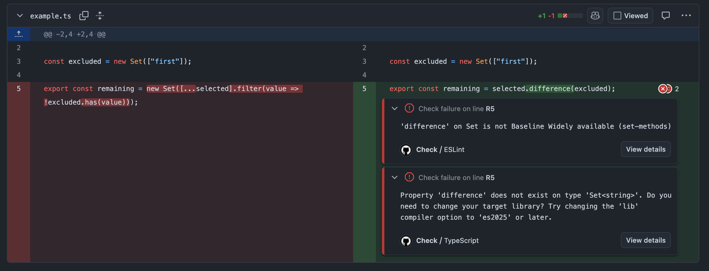

# Baseline checks demo

Catch JavaScript built-in APIs outside your Baseline target in your editor and CI.
This demo uses [TypeScript Baseline types](https://github.com/3ru/TypeScript-Baseline-lib-generator)
and [ESLint](https://github.com/3ru/eslint-plugin-baseline-js) with a pinned Baseline Widely available target.

## See CI catch an unsupported API

[PR #1](https://github.com/3ru/baseline-checks-demo/pull/1) changes one line to
`selected.difference(excluded)`. `difference()` is outside this demo's pinned
Baseline target, so the TypeScript and ESLint jobs both fail and flag the same call.

[](https://github.com/3ru/baseline-checks-demo/pull/1/files)

View the failed jobs: [ESLint](https://github.com/3ru/baseline-checks-demo/actions/runs/37277659669/job/111658183285)
and [TypeScript](https://github.com/3ru/baseline-checks-demo/actions/runs/37277659669/job/111658182906).

## Run the checks

Use Node 24 or later.

```sh
git clone https://github.com/3ru/baseline-checks-demo.git
cd baseline-checks-demo
npm ci
npm run lint
npm run typecheck
```

Both checks pass on `main`. [example.ts](example.ts) removes excluded values
from a Set using widely available APIs.

Switch to the PR branch to reproduce both errors:

```sh
git switch demo/unsupported-api
npm run lint
npm run typecheck
```

## See the errors in your editor

In VS Code, install the ESLint extension and select **Use Workspace Version** for
TypeScript. Open `example.ts` on the PR branch to see both errors.

The compiler uses [tsconfig.json](tsconfig.json) to restrict TypeScript to Baseline APIs.
ESLint applies the same target in [eslint.config.mjs](eslint.config.mjs); its separate
[tsconfig.eslint.json](tsconfig.eslint.json) retains full types to identify newer APIs.

Versions are pinned in `package.json` and `package-lock.json`: Baseline lib 0.1.1
(snapshot: 2026-10-02) and ESLint plugin 0.7.4 (web-features 3.40.0).
TypeScript 6.0.3 matches the ESLint parser's supported versions.
